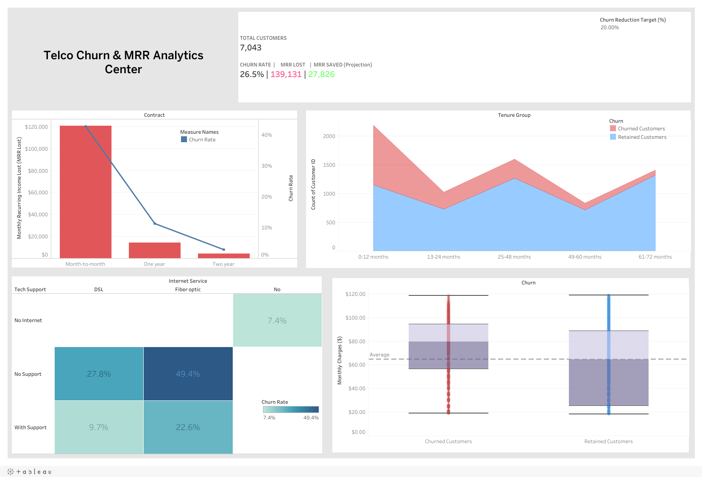

*Read this in other languages: [Español](README_es.md)*

# Telco Customer Churn & MRR Risk Analysis

## Interactive Dashboard

Explore the interactive analysis in Tableau Public:
[View Dashboard in Tableau Public](https://public.tableau.com/app/profile/armando.guarnera/viz/Telco_Churn_17825115564600/TelcoChurnMRRAnalyticsCenter)

## Dashboard Preview



## Project Context

This project addresses one of the most critical problems in telecommunications: **customer churn**. Acquiring a new subscriber usually costs far more than keeping an existing one.

Using the IBM Telco Customer Churn dataset (7,043 customers), the project goes beyond listing the drivers of churn. It quantifies the financial impact as lost **Monthly Recurring Revenue (MRR)** and gives the business an interactive what-if tool to size retention targets.

---

## Objectives

### Data Preparation in Python

* Programmatic ingestion of the raw dataset.
* Detection of hidden missing values: `TotalCharges` stores blank strings for 11 customers with zero tenure.
* Logical imputation: those customers have not been billed yet, so their accumulated charges are 0.
* Tenure bands (0-12, 13-24, 25-48, 49-60 and 61-72 months) and a numeric churn flag for Tableau calculations.

### Business-Oriented Metrics

* Focus on financial loss (**MRR lost**) rather than only on the number of customers who left.

### Advanced Tableau Calculations

* **Level of Detail (LOD)** expression for the global churn baseline.
* **What-if parameter** to project the MRR recovered under different churn reduction targets (default: 20%).

### Statistical Visualization

* **Box plots** to compare monthly charges between churned and retained customers.

---

## Tech Stack

### ETL and Data Preparation

* Python
* Pandas
* NumPy

### Analytics and Visualization

* Tableau Desktop / Tableau Public

---

## Dashboard Architecture

The dashboard is organized in five components designed to support business decisions.

### 1. Executive KPIs and What-If Parameter

Real-time calculation of:

* Total customers and churn rate.
* Total MRR lost.
* MRR recovered under an adjustable churn reduction target.

### 2. Revenue Loss by Contract (Dual Axis)

Contrasts lost MRR (bars) with the churn rate (line) for each contract type.

### 3. Churn by Tenure

Churned and retained customers across tenure bands, showing where in the customer lifecycle churn concentrates.

### 4. Fiber Optic Paradox (Root-Cause Matrix)

A heatmap of churn rate by internet service type and tech support subscription.

### 5. Price Sensitivity Box Plot

Monthly charges of churned vs. retained customers.

---

## Key Findings

### Churn Is a Revenue Problem, Not Just a Headcount Problem

**26.5%** of customers churned (1,869 of 7,043), taking **$139,131** of monthly recurring revenue with them: **30.5% of total MRR**. Churned customers pay more than average, so revenue churn is higher than customer churn.

### The Month-to-Month Contract Trap

Month-to-month contracts account for **86.9% of lost MRR**. Their churn rate is **42.7%**, versus **11.3%** for one-year and **2.8%** for two-year contracts.

### The Fiber Optic Paradox

Fiber optic, the premium service, churns at **41.9%** versus **19.0%** for DSL. Without tech support, fiber churn reaches **49.4%**; with it, it drops to **22.6%**. DSL customers with tech support churn at only **9.7%**.

This points to a service experience problem in the premium segment, not just a price problem.

### The First-Year Cliff

Churn is **47.4%** among customers in their first 12 months and falls steadily to **6.6%** after five years. **55.5%** of all churned customers left within their first year.

### Price Friction

Churned customers pay a median monthly charge of **$79.65**, versus **$64.43** for retained customers.

---

## Strategic Recommendations

### Encourage Long-Term Contracts

Offer migration incentives (temporary discounts, free bandwidth upgrades) to month-to-month customers, timed before the first renewal decisions of their first year.

### Fix the Fiber Optic Experience

Audit the fiber service (technical quality and onboarding) and consider including tech support by default in premium plans, where it is associated with less than half the churn.

### Review the Value of High-Price Plans

Customers who pay more churn more: review what the highest-priced plans deliver compared with their price.

---

## Limitations

The analysis is descriptive: it shows where churn concentrates, not what causes it. Contract type, tenure and price are related to each other (month-to-month customers are also newer), so the effect of each driver should be confirmed with a model or a controlled retention test before investing.

---

## How to Run This Project

```bash
git clone https://github.com/arguar13/Tableau-Telco-Churn.git
cd Tableau-Telco-Churn
pip install -r requirements.txt
python etl_pipeline.py
```

The script downloads the dataset and creates `Cleaned_Telco_Churn.csv` (both CSV files are also included in the repository). Then open `Telco_Churn.twbx` in Tableau Desktop or Tableau Public: the packaged workbook includes its data extract, so it opens directly.

---

## Data Source

IBM. *Telco Customer Churn* sample dataset (IBM Cognos Analytics sample data).

---

## Author

**Armando Guarnera**
Data Scientist
Argentina
