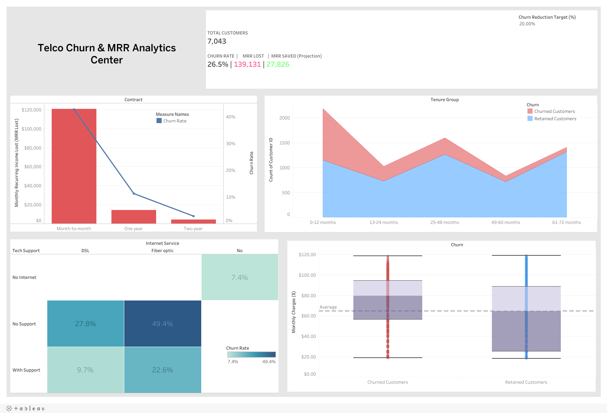

*Leer este documento en otros idiomas: [English](README.md)*

# Análisis de Riesgo de Churn y MRR en Clientes de Telecomunicaciones

## Dashboard Interactivo

Explora el análisis interactivo en Tableau Public:
[Ver Dashboard en Tableau Public](https://public.tableau.com/app/profile/armando.guarnera/viz/Telco_Churn_17825115564600/TelcoChurnMRRAnalyticsCenter)

## Vista Previa del Dashboard



## Contexto del Proyecto

Este proyecto aborda uno de los problemas más críticos de las telecomunicaciones: el **churn de clientes**. Adquirir un nuevo abonado suele costar mucho más que retener a uno existente.

Con el dataset IBM Telco Customer Churn (7.043 clientes), el proyecto va más allá de listar los factores del churn. Cuantifica el impacto financiero como **Ingreso Recurrente Mensual (MRR)** perdido y le da al negocio una herramienta interactiva what-if para dimensionar objetivos de retención.

---

## Objetivos

### Preparación de Datos en Python

* Ingesta programática del dataset original.
* Detección de valores faltantes ocultos: `TotalCharges` guarda cadenas vacías para 11 clientes con antigüedad cero.
* Imputación lógica: esos clientes todavía no fueron facturados, por lo que su cargo acumulado es 0.
* Bandas de antigüedad (0-12, 13-24, 25-48, 49-60 y 61-72 meses) y un indicador numérico de churn para los cálculos en Tableau.

### Métricas Orientadas al Negocio

* Foco en la pérdida financiera (**MRR perdido**) y no solo en la cantidad de clientes que se fueron.

### Cálculos Avanzados en Tableau

* Expresión **Level of Detail (LOD)** para la línea base global de churn.
* **Parámetro what-if** para proyectar el MRR recuperado con distintos objetivos de reducción de churn (valor por defecto: 20%).

### Visualización Estadística

* **Box plots** para comparar los cargos mensuales de clientes que se fueron y clientes retenidos.

---

## Tecnologías Utilizadas

### ETL y Preparación de Datos

* Python
* Pandas
* NumPy

### Analítica y Visualización

* Tableau Desktop / Tableau Public

---

## Arquitectura del Dashboard

El dashboard se organiza en cinco componentes diseñados para apoyar decisiones de negocio.

### 1. KPIs Ejecutivos y Parámetro What-If

Cálculo en tiempo real de:

* Total de clientes y tasa de churn.
* MRR total perdido.
* MRR recuperado según un objetivo ajustable de reducción de churn.

### 2. Pérdida de Ingresos por Contrato (Doble Eje)

Contrasta el MRR perdido (barras) con la tasa de churn (línea) para cada tipo de contrato.

### 3. Churn por Antigüedad

Clientes que se fueron y clientes retenidos por banda de antigüedad, para ver en qué etapa del ciclo de vida se concentra el churn.

### 4. La Paradoja de la Fibra Óptica (Matriz de Causa Raíz)

Un mapa de calor de la tasa de churn por tipo de servicio de internet y contratación de soporte técnico.

### 5. Box Plot de Sensibilidad al Precio

Cargos mensuales de clientes que se fueron frente a clientes retenidos.

---

## Hallazgos Clave

### El Churn Es un Problema de Ingresos, No Solo de Clientes

El **26,5%** de los clientes se fue (1.869 de 7.043) y se llevó **$139.131** de ingreso recurrente mensual: el **30,5% del MRR total**. Los clientes que se van pagan más que el promedio, por eso el churn de ingresos es mayor que el churn de clientes.

### La Trampa del Contrato Mes a Mes

Los contratos mes a mes concentran el **86,9% del MRR perdido**. Su tasa de churn es **42,7%**, frente a **11,3%** en contratos de un año y **2,8%** en contratos de dos años.

### La Paradoja de la Fibra Óptica

La fibra óptica, el servicio premium, tiene un churn de **41,9%** frente a **19,0%** en DSL. Sin soporte técnico, el churn de fibra llega a **49,4%**; con soporte baja a **22,6%**. Los clientes de DSL con soporte técnico tienen un churn de solo **9,7%**.

Esto apunta a un problema de experiencia de servicio en el segmento premium, no solo de precio.

### El Acantilado del Primer Año

El churn es **47,4%** entre los clientes en sus primeros 12 meses y baja de forma sostenida hasta **6,6%** después de cinco años. El **55,5%** de todos los clientes que se fueron lo hizo durante su primer año.

### Fricción por Precio

Los clientes que se fueron pagan un cargo mensual mediano de **$79,65**, frente a **$64,43** de los clientes retenidos.

---

## Recomendaciones Estratégicas

### Fomentar Contratos de Largo Plazo

Ofrecer incentivos de migración (descuentos temporales, mejoras gratuitas de ancho de banda) a los clientes mes a mes, antes de las primeras decisiones de renovación de su primer año.

### Mejorar la Experiencia de Fibra Óptica

Auditar el servicio de fibra (calidad técnica y proceso de incorporación) y evaluar incluir el soporte técnico por defecto en los planes premium, donde se asocia con menos de la mitad del churn.

### Revisar el Valor de los Planes de Mayor Precio

Los clientes que pagan más se van más: revisar qué entregan los planes más caros en relación con su precio.

---

## Limitaciones

El análisis es descriptivo: muestra dónde se concentra el churn, no qué lo causa. El tipo de contrato, la antigüedad y el precio están relacionados entre sí (los clientes mes a mes también son más nuevos), así que el efecto de cada factor debería confirmarse con un modelo o una prueba controlada de retención antes de invertir.

---

## Cómo Ejecutar Este Proyecto

```bash
git clone https://github.com/arguar13/Tableau-Telco-Churn.git
cd Tableau-Telco-Churn
pip install -r requirements.txt
python etl_pipeline.py
```

El script descarga el dataset y genera `Cleaned_Telco_Churn.csv` (ambos CSV también están incluidos en el repositorio). Luego abre `Telco_Churn.twbx` en Tableau Desktop o Tableau Public: el workbook empaquetado incluye su extracto de datos, así que abre directamente.

---

## Fuente de Datos

IBM. Dataset de ejemplo *Telco Customer Churn* (datos de ejemplo de IBM Cognos Analytics).

---

## Autor

**Armando Guarnera**
Científico de Datos
Argentina
